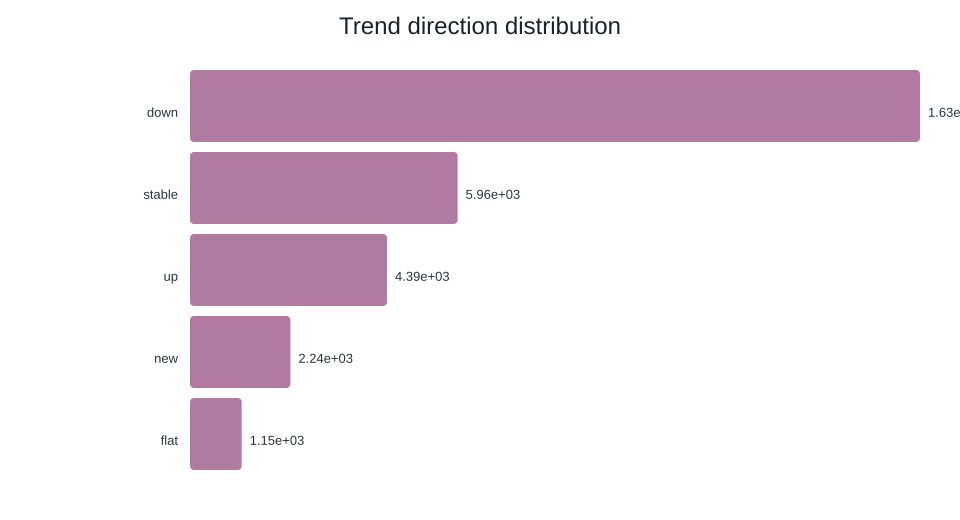
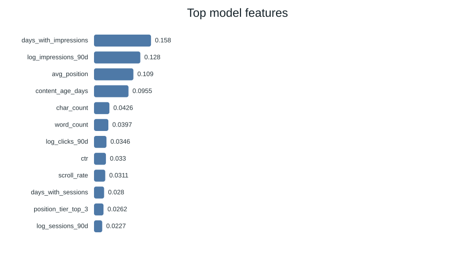
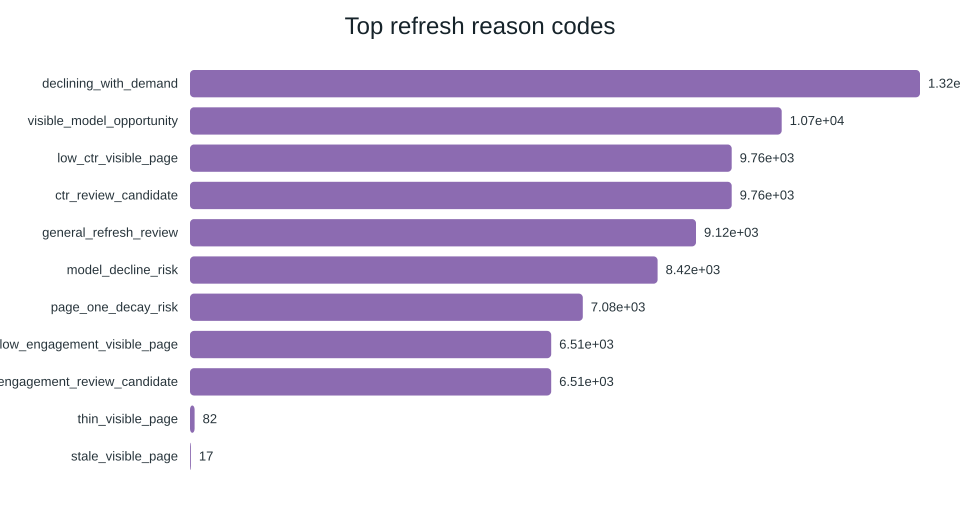
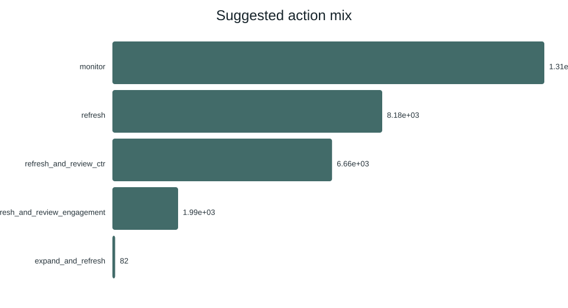
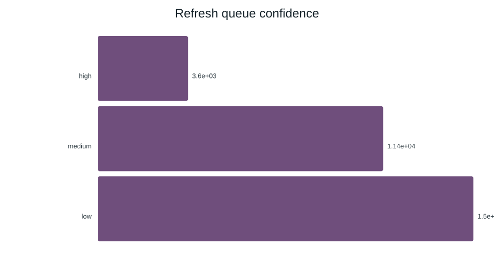

Content Refresh Prioritization Using Machine Learning
A Decision-Support Approach for Identifying Content Items That May Require Review
FlyRank AI Internship — Machine Learning Track
Prepared by: Panga Keerthi
GitHub Repository: keerthi-flyrank-ml-internship-2026
---
1. Abstract
## 1. Abstract

FlyRank's content operations involve identifying content items that may be declining and prioritizing them for review. This project investigates whether machine learning can improve the prioritization of potentially declining content compared with a rule-based baseline. Using an anonymized dataset of 30,000 content records, we developed and evaluated Logistic Regression, Decision Tree, and Random Forest models using a client-holdout validation strategy. The Random Forest model achieved a Precision@50 of 0.74, compared with 0.24 for the baseline, on the evaluation dataset. These findings suggest that machine learning can support a more focused content-review process, while final decisions should remain with human reviewers.
2. Introduction / Problem Statement
## 2. Introduction / Problem Statement

Content performance can change over time. Some previously performing content items may experience declining visibility or engagement, making it important for content teams to identify which items may need attention.

For FlyRank's content operations, reviewing a large number of content items manually can make prioritization difficult. A systematic approach can help analysts identify potentially declining content and organize it into a ranked review queue.

This project explores how machine learning can support this process. It compares a rule-based baseline with three machine learning models: Logistic Regression, Decision Tree, and Random Forest. The models use historical content-performance signals to identify records associated with a declining trend.

The project uses an anonymized dataset containing 30,000 content records. The objective is to evaluate whether machine learning can improve the prioritization of content for human review. The resulting predictions are intended as decision-support signals, not automatic instructions to modify content.
3. Data
The project uses the anonymized content-refresh dataset supplied for the FlyRank Machine Learning Internship.
The raw dataset contains:
30,000 rows
44 original columns
32 pseudonymized clients
Each row represents a content item. The dataset includes content and performance information such as impressions, clicks, sessions, average search position, click-through rate, content age, days since the last update, word count, content type, search intent, competition level, and trend information.
The supplied dataset description refers to trailing 90-day measurements and comparisons with a previous 30-day period.
The target variable is `is_declining_label`. It is set to 1 when `trend_direction` equals "down" and 0 otherwise.
The processed feature set contains 52 model features. To reduce leakage, `content_id`, `client_id`, `trend_direction`, and `trend_pct` are excluded from the model predictors.
The raw and processed datasets each contain 30,000 rows in the completed pipeline.
4. Methodology
4.1 Data Preparation and Feature Generation
The official internship pipeline prepares the feature vector from the raw dataset, generates a baseline score, trains candidate models, and exports evaluation results and a ranked queue.
The processed feature vector contains 52 model features. The workflow retains the supplied target label for model training and evaluation while excluding specified identifier and target-derived columns from the predictors.
4.2 Validation Strategy
The project uses the `client_holdout` validation strategy.
The completed split contains:
Training rows: 27,675
Test rows: 2,325
This approach evaluates performance on held-out client data and reduces the risk of overly optimistic results caused by having records from the same clients in both training and testing.
4.3 Models and Baseline
Three supervised machine-learning classifiers are compared:
Decision Tree
Logistic Regression
Random Forest
Their performance is compared with the project's rule-based baseline ranking.
The baseline combines signals such as visibility, freshness risk, position opportunity, and content-depth gap to prioritize records without relying on the trained classifiers.
4.4 Evaluation Measures and Model Selection
Precision@50 is the primary model-selection metric because the workflow is designed to present a limited, high-priority review list.
ROC-AUC and Average Precision provide additional views of ranking and classification performance. F1 and recall are also reported for context.
Random Forest is selected because it achieves the highest Precision@50 among the evaluated models.
4.5 Ranked Queue
The pipeline exports a ranked refresh queue containing the final ranking, model and baseline scores, confidence information, suggested action, and reason codes.
The queue helps analysts prioritize manual investigation. A high rank is a review signal, not an instruction to edit or remove a page automatically.
5. Results
The completed evaluation results are summarized below. Values are reported from the project's `model_results.json` output.
Model	Precision@50	ROC-AUC	Average Precision	F1	Recall
Decision Tree	0.58	0.7415	0.5753	0.6339	0.7162
Logistic Regression	0.40	0.7003	0.5215	0.5662	0.5666
Random Forest	0.74	0.7500	0.6182	0.6395	0.7437
Baseline	0.24	0.6269	0.4676	0.2743	0.1892
Random Forest performs best on the primary metric, with Precision@50 of 0.74. Decision Tree reaches 0.58 and Logistic Regression reaches 0.40. The baseline Precision@50 is 0.24.
On this evaluation, the Random Forest top-50 list contains 37 records with the declining label, while the baseline top-50 list contains 12.
Random Forest also records the highest ROC-AUC and Average Precision among the three trained models. These results support selecting Random Forest for the project's ranked review queue under the chosen evaluation procedure.
The exported feature-importance results identify `days_with_impressions`, `log_impressions_90d`, `avg_position`, and `content_age_days` among the highest-ranked features for the Random Forest model.
Feature importance indicates which inputs contributed to the model's fitted decisions; it does not by itself demonstrate causation.
Evaluation and Analysis Charts
The following charts provide additional views of the dataset and model outputs.

Figure 1: Distribution of content trend directions.

Figure 2: Top features contributing to the Random Forest model.

Figure 3: Most common reason codes in the refresh queue.

Figure 4: Distribution of recommended actions.

Figure 5: Confidence distribution of the model predictions.

6. Limitations
The project has several limitations:
The dataset is anonymized and limited to the records supplied for the internship. Results may not generalize to every website, industry, or content strategy.
The target label is derived from the recorded `trend_direction` field. The model is evaluated against this label and should not be described as a proven predictor of future decline.
Client-holdout evaluation provides a more demanding test across client groups, but performance may change when applied to new data or different time periods.
The dataset's measurements and labels may contain noise, missing context, or changes in tracking and search behavior.
Feature-importance rankings describe model behavior, not causal explanations.
Precision@50 focuses on the quality of a small top-ranked list. It does not describe the quality of every item in the full queue.
7. Recommendations
Based on the project results, the following recommendations are proposed:
Use the Random Forest ranking as a starting point for analyst review because it achieved the highest Precision@50.
Review high-priority items manually before making content changes.
Check search intent, page quality, freshness, technical health, and business importance.
Use the reason codes and supporting metrics in the exported queue to guide investigation rather than relying on a score alone.
Track the outcomes of reviewed recommendations and periodically compare them with later performance data.
Retrain and re-evaluate the models when newer, appropriately prepared data becomes available.
Treat the system as decision support. Do not automatically rewrite, remove, or publish content based only on the model score.
8. Reproducibility
The project is organized in the public GitHub repository:
GitHub Repository
The main notebook is:
Open the Capstone Notebook
The pipeline uses the supplied raw dataset and internship scripts to generate the processed feature vector, baseline queue, model evaluation output, model report, and final refresh queue.
Key Generated Outputs
`data/processed/refresh_feature_vector.csv`
`data/processed/baseline_refresh_queue.csv`
`outputs/model_results.json`
`outputs/model_report.md`
`outputs/refresh_queue.csv`
`outputs/charts/` — generated evaluation and analysis charts
Pipeline Scripts
The completed pipeline stages are:
`01_prepare_features.py`
`02_baseline_score.py`
`03_train_model.py`
`04_evaluate_and_export.py`
To reproduce the analysis, use the project's documented environment and dataset access instructions, place the supplied raw CSV at the expected `data/raw` location, and run the notebook from top to bottom.
Reproduction depends on access to the internship dataset and required Python packages. The public repository should not contain access tokens, credentials, or private client information.
9. Acknowledgments and Data Credit
This capstone was completed as part of the FlyRank AI Internship, Machine Learning track.
Built on the FlyRank ML Internship dataset, using the anonymized internship dataset and starter workflow provided for educational purposes.
FlyRank Website: https://flyrank.ai
The analysis, model comparison, and written interpretation in this paper describe the student's implementation of the internship capstone workflow. The results should be interpreted within the scope and limitations of the supplied dataset and evaluation design.
---
Project: FlyRank AI Internship — Machine Learning Capstone
Author: Panga Keerthi
